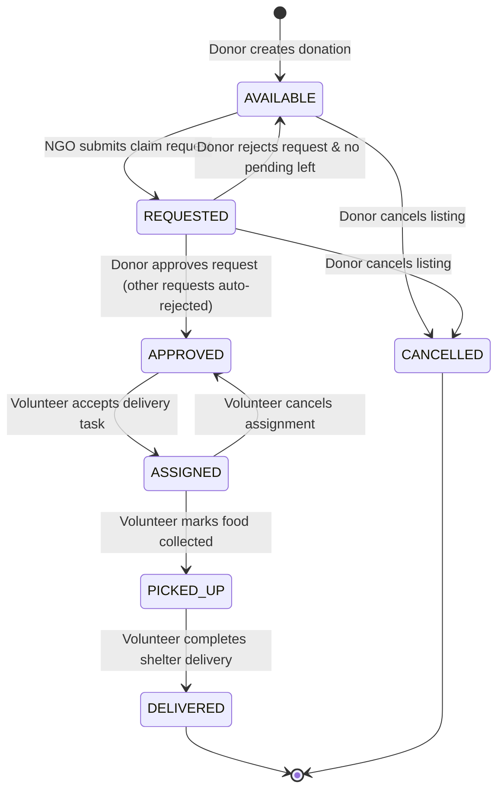

# FoodConnect – Food Donation and Distribution Platform

[](https://www.oracle.com/java/)
[](https://spring.io/projects/spring-boot)
[](https://spring.io/projects/spring-security)
[](https://www.mysql.com/)
[](https://vitejs.dev/)
[](https://junit.org/junit5/)

FoodConnect is an end-to-end full-stack web application designed to eliminate food waste and fight urban hunger. It connects surplus food donors (restaurants, bakeries, caterers) with verified NGOs and volunteer couriers through a strictly enforced, real-time donation lifecycle.

---

## 1. System Architecture & Lifecycle

FoodConnect enforces a synchronized state machine with role-based permissions and optimistic locking to prevent race conditions during claims and deliveries.



### Role-Based Access Control (RBAC) Matrix

| Feature / Action | Donor (`ROLE_DONOR`) | NGO (`ROLE_NGO`) | Volunteer (`ROLE_VOLUNTEER`) |
| :--- | :---: | :---: | :---: |
| Register & Login (JWT) | ✅ | ✅ | ✅ |
| Create Food Donation | ✅ | ❌ | ❌ |
| Edit / Cancel Own Donation | ✅ | ❌ | ❌ |
| Browse Available Food | ✅ | ✅ | ✅ |
| Request Food Donation | ❌ | ✅ | ❌ |
| Approve / Reject NGO Requests | ✅ | ❌ | ❌ |
| Accept Delivery Task | ❌ | ❌ | ✅ |
| Confirm Pickup / Delivery | ❌ | ❌ | ✅ |
| View Delivery History | ❌ | ❌ | ✅ |

---

## 2. Technology Stack

### Backend
- **Java 17** (compatible with Java 17 through 24)
- **Spring Boot 3.3.4**
- **Spring Security 6** with Stateless JWT Authentication (`io.jsonwebtoken:jjwt-api:0.12.6`)
- **Spring Data JPA** & **Hibernate ORM 6**
- **Bean Validation (Jakarta Validation)**
- **MySQL 8.0** (Production/Development) & **H2 Database** (Test Isolation)
- **Maven 3.9** (Included with Maven Wrapper `mvnw` and `mvnw.cmd`)

### Frontend
- **React 18** with **Vite**
- **Vanilla CSS** with a custom design system tokens & accessible components
- **Axios** with JWT Request/Response interceptors
- **React Router DOM 6** with declarative role-protected routes
- **Lucide React** for modern UI icons

---

## 3. Project Structure

```text
FoodConnect/
├── backend/
│   ├── .mvn/wrapper/
│   ├── src/
│   │   ├── main/
│   │   │   ├── java/com/foodconnect/
│   │   │   │   ├── config/            # SecurityConfig, CorsConfig
│   │   │   │   ├── controller/        # REST API Controllers (Auth, Donation, Request, Delivery)
│   │   │   │   ├── dto/               # Request & Response DTOs
│   │   │   │   ├── entity/            # JPA Entities & Enums (User, FoodDonation, etc.)
│   │   │   │   ├── exception/         # GlobalExceptionHandler & Custom Exceptions
│   │   │   │   ├── repository/        # Spring Data JPA Repositories
│   │   │   │   ├── security/          # JwtTokenProvider, JwtFilter, CustomUserDetailsService
│   │   │   │   └── service/           # Core Business Logic & State Transitions
│   │   │   └── resources/
│   │   │       └── application.properties
│   │   └── test/
│   │       ├── java/com/foodconnect/service/ # JUnit 5 Mockito Tests
│   │       └── resources/
│   │           └── application.properties    # H2 In-Memory Test Profile
│   ├── FoodConnect.postman_collection.json   # Ready-to-import Postman Collection
│   ├── pom.xml
│   ├── mvnw
│   └── mvnw.cmd
├── database/
│   ├── schema.sql                     # Full MySQL 8 DDL Schema & Indexes
│   └── sample-data.sql                # Seed Users (BCrypt), Donations, and Categories
├── frontend/
│   ├── src/
│   │   ├── api/client.js              # Axios Client & Endpoints
│   │   ├── components/                # Navbar, ProtectedRoute, StatusBadge
│   │   ├── context/AuthContext.jsx    # Authentication & Session State
│   │   ├── pages/                     # Donor, NGO, Volunteer & Auth Pages
│   │   ├── App.jsx                    # Routing & Guards
│   │   ├── index.css                  # CSS Design System
│   │   └── main.jsx
│   ├── package.json
│   ├── vite.config.js
│   └── index.html
└── README.md
```

---

## 4. Database Design (MySQL 8)

The schema defines relational constraints, foreign keys, and indexes for query performance:

- **`users`**:
  - `id` (BIGINT, PK, Auto-Increment)
  - `full_name`, `email` (Unique, Indexed), `password` (BCrypt), `phone`, `role` (Indexed), `address`, `created_at`
- **`food_donations`**:
  - `id` (BIGINT, PK, Auto-Increment)
  - `title`, `description`, `category` (Indexed), `quantity`, `servings`, `pickup_address`
  - `prepared_at`, `expires_at` (Indexed), `status` (Indexed), `donor_id` (FK -> users.id)
  - `version` (BIGINT, Optimistic Locking)
- **`donation_requests`**:
  - `id` (BIGINT, PK, Auto-Increment)
  - `donation_id` (FK -> food_donations.id), `ngo_id` (FK -> users.id)
  - `message`, `status` (`PENDING`, `APPROVED`, `REJECTED`), `requested_at`
- **`deliveries`**:
  - `id` (BIGINT, PK, Auto-Increment)
  - `donation_id` (FK -> food_donations.id, Unique to ensure 1 delivery per donation)
  - `volunteer_id` (FK -> users.id)
  - `status` (`ASSIGNED`, `PICKED_UP`, `DELIVERED`, `CANCELLED`)
  - `pickup_time`, `delivered_at`, `created_at`

---

## 5. REST API Reference

### Authentication (`/api/auth`)
| Method | Endpoint | Access | Description |
| :--- | :--- | :--- | :--- |
| `POST` | `/api/auth/register` | Public | Register new User (`ROLE_DONOR`, `ROLE_NGO`, `ROLE_VOLUNTEER`) |
| `POST` | `/api/auth/login` | Public | Authenticate credentials and receive Bearer JWT |
| `GET` | `/api/auth/me` | Authenticated | Retrieve current user profile |

### Food Donations (`/api/donations`)
| Method | Endpoint | Access | Description |
| :--- | :--- | :--- | :--- |
| `POST` | `/api/donations` | `ROLE_DONOR` | Publish new food donation |
| `GET` | `/api/donations` | Public / Auth | Browse available food donations (filter by `category`, `status`) |
| `GET` | `/api/donations/{id}` | Public / Auth | Get donation details by ID |
| `GET` | `/api/donations/my` | `ROLE_DONOR` | Get donations created by logged-in donor |
| `PUT` | `/api/donations/{id}` | `ROLE_DONOR` | Update donation details (allowed if `AVAILABLE` or `REQUESTED`) |
| `PATCH` | `/api/donations/{id}/status` | `ROLE_DONOR` | Cancel or update status |
| `DELETE` | `/api/donations/{id}` | `ROLE_DONOR` | Remove donation |

### Donation Requests (`/api/donation-requests`)
| Method | Endpoint | Access | Description |
| :--- | :--- | :--- | :--- |
| `POST` | `/api/donation-requests` | `ROLE_NGO` | Request a food donation (checks expiry & duplicate requests) |
| `GET` | `/api/donation-requests/my` | `ROLE_NGO` | Get requests submitted by the logged-in NGO |
| `GET` | `/api/donation-requests/received` | `ROLE_DONOR` | Get requests received for donor's listings |
| `PATCH` | `/api/donation-requests/{id}/status`| `ROLE_DONOR` | Approve or Reject request (auto-transitions donation status) |

### Deliveries (`/api/deliveries`)
| Method | Endpoint | Access | Description |
| :--- | :--- | :--- | :--- |
| `GET` | `/api/deliveries/available` | `ROLE_VOLUNTEER` | View approved donations awaiting courier assignment |
| `POST` | `/api/deliveries/{donationId}/accept` | `ROLE_VOLUNTEER` | Claim delivery assignment |
| `GET` | `/api/deliveries/my` | `ROLE_VOLUNTEER` | View assigned and completed deliveries |
| `PATCH` | `/api/deliveries/{id}/status` | `ROLE_VOLUNTEER` | Update status to `PICKED_UP` or `DELIVERED` |

---

## 6. How to Run Locally

### Prerequisites
- Java 17+ installed
- Node.js 18+ and npm installed
- MySQL 8.0 running locally

### Step 1: Configure the Database
1. Open your MySQL client (Command Line, MySQL Workbench, or DBeaver).
2. Execute the schema script:
   ```bash
   mysql -u root -p < database/schema.sql
   mysql -u root -p < database/sample-data.sql
   ```
   *(Alternatively, Hibernate will auto-create the schema on first run via `ddl-auto=update`)*.

### Step 2: Configure Environment Variables
You can customize settings using environment variables or modify `backend/src/main/resources/application.properties`.
Copy `backend/.env.example` as reference:
```env
DB_URL=jdbc:mysql://localhost:3306/foodconnect_db?createDatabaseIfNotExist=true&useSSL=false&serverTimezone=UTC&allowPublicKeyRetrieval=true
DB_USERNAME=root
DB_PASSWORD=your_mysql_password
JWT_SECRET=404E635266556A586E3272357538782F413F4428472B4B6250645367566B5970
PORT=8080
```

### Step 3: Run the Backend
Open a terminal in `backend/`:
```bash
# Windows
.\mvnw.cmd spring-boot:run

# Linux / macOS
./mvnw spring-boot:run
```
The backend starts on `http://localhost:8080`.

### Step 4: Run the Frontend
Open a new terminal in `frontend/`:
```bash
npm install
npm run dev
```
Open your browser at `http://localhost:5173`.

---

## 7. Demo Credentials

Pre-seeded in `database/sample-data.sql` and supported with one-click fill on the Login page:

| Role | Email | Password |
| :--- | :--- | :--- |
| **Donor** | `donor@foodconnect.org` | `password123` |
| **NGO** | `ngo@foodconnect.org` | `password123` |
| **Volunteer** | `volunteer@foodconnect.org` | `password123` |

---

## 8. Automated Testing

Run the test suite using Maven:
```bash
# In backend/
.\mvnw.cmd test
```
All 15 unit tests verify:
- User registration and duplicate prevention
- BCrypt hashing and JWT generation
- Food donation expiration and preparation validation
- Unauthorized role access rejection
- NGO duplicate request prevention
- Atomic request approval & competing request rejection
- Volunteer claim transitions (`APPROVED` -> `ASSIGNED` -> `PICKED_UP` -> `DELIVERED`)

---

## 9. Technical Interview & B.Tech Resume Highlights

Key architectural concepts to highlight during technical interviews:

1. **State Machine & Concurrency Control**:
   - Used `@Version` on `FoodDonation` to enforce **Optimistic Concurrency Control**, eliminating race conditions where two volunteers attempt to claim the same delivery task simultaneously.
   - Handled competing NGO requests: When a donor approves an NGO's request, the service atomically updates the chosen request to `APPROVED`, changes the donation to `APPROVED`, and rejects other pending claims in a single `@Transactional` boundary.

2. **Stateless Security with JWT & Spring Security 6**:
   - Implemented a custom `OncePerRequestFilter` (`JwtAuthenticationFilter`) that extracts Bearer tokens, validates signatures via `HMAC-SHA256`, and populates `SecurityContextHolder`.
   - Used `@EnableMethodSecurity` and `@PreAuthorize("hasAuthority('ROLE_...')")` for granular, method-level authorization.

3. **Domain-Driven DTOs & Validation**:
   - Strict separation between JPA entities and API contracts using Request/Response DTOs.
   - Server-side Bean Validation (`@NotNull`, `@Future`, `@Size`, `@NotBlank`) catches bad payloads before hitting business services.

4. **Centralized Error Handling**:
   - Implemented `@RestControllerAdvice` (`GlobalExceptionHandler`) to provide consistent REST error envelopes with HTTP status codes (400, 401, 403, 404, 409).
